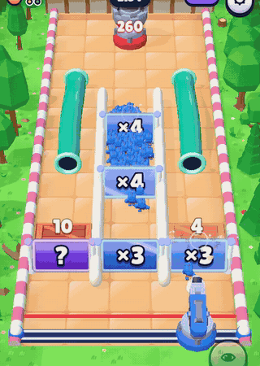
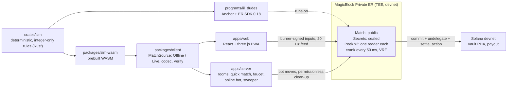

<p align="center">
  
</p>

<h3 align="center">A live 1v1 crowd-cannon duel with hidden gates and real stakes, sealed inside a MagicBlock Private Ephemeral Rollup.</h3>

<p align="center">
  <!-- TODO(Kai): replace https://TBD with the hosted web URL once [DEPLOYED] is in PROGRESS_LOG. -->
  <a href="https://TBD"><b>&#9654;&nbsp; PLAY NOW</b></a>
  &nbsp;·&nbsp; phone or desktop &nbsp;·&nbsp; no wallet needed to start &nbsp;·&nbsp; Solana devnet
</p>

---

## What it is

You know the game from the ads: a cannon pours a crowd of little dudes through multiplier gates at
an enemy base. **Lil Dudes Go Brr makes it a fair, live head-to-head race.** Two players fire at
identical copies of the same level, every gate is a hidden `?` until a dude touches it, and devnet
SOL is on the line. The hidden values live in sealed accounts inside a MagicBlock Private Ephemeral
Rollup, the level is dealt by VRF, an on-chain crank runs the clock at 20 Hz, and the result pays
out on Solana by itself. Open the link and you're playing the bot within seconds: no wallet, no
popups, no sign-up.

<!-- TODO(Suparno): record docs/assets/gameplay.gif on a phone (~8 s: aim → a ? flips → Champion → BREACH → Rush). -->
<p align="center">
  
</p>

## How a match works

- **Hold to fire, drag to aim.** The cannon shoots only while your thumb is down.
- **Hidden `?` gates.** Most multiply (×2–×5, +N), some hurt (÷2, ÷3, −N). A gate flips face-up
  in your copy the first time your dudes touch it. Big ×6–×10 gates sit exposed in awkward spots
  or behind a breakable crate; one **timing gate** per stage cycles ×1 → ×5 in plain sight.
- **Scout.** Once per stage, privately see the true value of one of your face-down gates.
  Only you can read it.
- **Champion.** Shooting charges a meter. Let go with it full and a giant worth 8 dudes marches
  out, multiplying through gates like any crowd.
- **Levels.** Walls, wedges, pillar fields, speed pads, pipes and breakable blocks. Six two-stage
  layouts, all simulated in the deterministic rules and identical for both players.
- **Towers, then the town hall.** Fight 1 has one tower; Fight 2 has two guarding the town hall.
  Drop the last one and you **BREACH**: a 3.5 s **Rush** in which every dude that reaches the hall
  scores.
- **Your own pace, one clock.** A thin bar shows how far the opponent is. The match is capped at
  **3:00**.
- **KO.** If a single enemy reaches your cannon line, you're overrun and lose your whole stake.
- **Score and payout.** Score = tower damage + 50 per tower + 50 for breaching a fight **first** +
  2 per dude in the Rush. If both survive, the winner keeps their stake plus **2 × the winning
  margin** of the loser's (all of it once the winner scores 3× as much). Equal scores are a draw,
  and stakes go back. **5% fee, only on what moves.**

Full rules: [docs/SPEC.md](docs/SPEC.md) (base) and [docs/SPEC_V5.md](docs/SPEC_V5.md) (rules v5 and later).

## Why MagicBlock: remove it and what breaks

Every piece does real work. Take any one out and the game stops being fair, live or paid.

| Piece | What it does here | Remove it and… |
|---|---|---|
| **Private Ephemeral Rollup (TEE) + ephemeral permissions** | `Match` (public), `Secrets` and one `Peek` per player are delegated to the TEE validator. `Secrets` (seed, every true gate value) has a permission with **no members**; each `Peek` has exactly one member, its player's key. Every transaction carrying secret input touches one of them, so it is redacted for everyone else. | …any modified client reads every `?` and the opponent's Scout. The bluff is gone; the game becomes a lookup table. |
| **Ephemeral Rollup at 20 Hz** | The whole match runs on chain: 1 tick = 5 rollup slots = 50 ms. Aim, fire, Champion and Scout are free transactions. State reaches both players over the rollup's websocket at ~20 updates/s. | …a real-time match on the base layer: ~400 ms slots and a fee on every input. Unplayable. |
| **VRF** | One verifiable random value per match, mixed with both players' private salts (`seed = sha256(vrf ‖ salt₀ ‖ salt₁)`), picks the layout and deals every gate. The callback lands ~2 slots after the request. | …someone has to choose the deal: a player, or a server you must trust. No provably fair Verify. |
| **Crank** (scheduled `advance` every 50 ms) | Moves the clock on chain whether or not anyone sends a transaction. `advance` is idempotent catch-up (≤ 8 ticks a call), so a late crank never changes the outcome. | …the clock stops when a player goes idle or leaves, and the opponent's match stalls with it. A server would have to become the referee. |
| **Delegation, commit + undelegate, Magic Action** | Stakes sit in a base-layer vault PDA. `finish` publishes the seed and the Scout history, commits and undelegates all four accounts **once**, and schedules `settle_action`, which pays winner, loser and fee from the vault. If the action ever fails, anyone can call `settle`. | …the result never leaves the rollup, and the pot sits in escrow until someone trusted signs a payout. |
| **TEE auth from a burner key** | A per-device burner keypair, made silently in the browser, signs the TEE login and every in-match transaction. A 0-SOL burner can play; only staking needs SOL. (A plain burner, not MagicBlock session keys.) | …a wallet popup on every input, ~10 a second. |

## Proof: try to cheat

| Claim | How to check it | Status |
|---|---|---|
| Sealed accounts can't be read mid-match | `packages/client/scripts/privacy-check.ts` plays a live match on the TEE while the opponent, a stranger and a token-less client try every path: `getAccountInfo`, `getProgramAccounts`, `accountSubscribe`, `programSubscribe`, logs, `getTransaction`, signatures. **2 runs, 0 leaks**; results in `packages/client/scripts/out/privacy-*.json`, the full table in [TECH §4](docs/TECH.md#privacy-what-must-never-leak). | Done on devnet (program of 22 Nov). Re-run on the final program: TODO. |
| The deal was fair | After the match the seed and every Scout are public. `packages/client/src/verify.ts` rebuilds the layout and every gate's true value from the seed with the same Rust rules (WASM), to compare with what was revealed. | Done: the **Verify** button on a live match's result rebuilds the deal from the on-chain seed and checks it against what was revealed. |
| In-app "try to read the sealed accounts" console | A button that fires the denied reads from your own browser. | Not built. |
| The program does what it says | **MagicSVM 19/19** (`tests-magicsvm/`): every instruction, refused cases, money edges, timeout refunds, plus a compute bench. | Green on rules v9. |
| Payouts add up | `tools/balance/settle_fuzz.py`: 300k random cases of the current payout, `winner + loser + fee = 2S` to the lamport. Three live devnet matches (22 Nov) paid out exactly by the Magic Action. | Done. |
| It all happened on Solana | Program, settle transactions and match accounts on the explorer (below). | Links: TODO after the final deploy. |

## Architecture



One Rust rules crate runs in the program, the browser (offline play and Verify) and the server
bot; golden tests and a WASM parity digest keep them identical. The web app talks to the game only
through `packages/client`, so offline and live play draw the same way. The server is **not in the
trust path**: everything it does on chain is permissionless or its own player's move, and every
refund goes to the players recorded in the match.

## Limits

- **TEE trust.** Privacy rests on MagicBlock's TEE validator: Intel TEE hardware and its
  attestation. If that hardware or its operator were compromised, sealed values could be read
  mid-match. The client does not check the enclave's attestation itself.
- **Devnet only, play money.** Stakes are devnet SOL. The program stays upgradeable through
  judging so a bug can still be fixed; the upgrade authority is the team's deploy wallet.
- **On-chain compute.** Every tick runs the full rules on chain. The worst tick (full lanes: 40
  crowds and 16 enemy groups per side) costs ~44k CU, and the crank's 8-tick catch-up must fit in
  400k. That caps the simulation at 40 crowd groups per side (the thousands of dudes you see are
  drawn from those counts) and keeps obstacle and steering rules simple. Rules are frozen before
  each deploy and re-benched.
- **The bot is off-chain.** *Play vs Bot* runs entirely in your browser (WASM rules and bot):
  nothing touches the chain and nothing is staked. The online bot that fills an empty Quick Match
  is a server process playing through the same public transactions as a human, in free matches
  only; it can't read sealed accounts either.
- **A leader leaks a little.** Revealed gates are public state, and both copies hold the same
  values. The UI only shows a progress bar, but a modified client that is behind could read gates
  the leader has already flipped.
- **Verify checks the deal, not every move.** Aim inputs are not logged on chain, so Verify
  re-derives the level, gate values and Scouts from the seed rather than replaying the whole match.
- **Your game key comes from one wallet signature.** Connecting a wallet signs a fixed message
  once; the game key is derived from that signature, so it comes back on any device. A site that
  tricked your wallet into signing that exact message could rebuild your game key, so the message
  says to sign it only here. It only ever holds devnet play money.
- **One server instance.** Rooms, the queue, top-ups and the bot live in memory on one instance. If
  it is down, Quick Match, room codes and top-ups stop; Play vs Bot still works.
- **Not battle-tested at scale.** Live matches have run on devnet bot-vs-bot and in the privacy
  check, but many concurrent human matches have not.

## Run it locally

Front-end work needs only Node ≥ 22.12 and pnpm 10 (the rules ship prebuilt as WASM).

```bash
corepack enable          # pnpm 10, pinned in package.json
pnpm install
pnpm dev:web             # the game; --host, so a phone on the same Wi-Fi can open it
pnpm dev:server          # rooms, quick match, faucet on :8787 (keys in apps/server/.env, see .env.example)
pnpm typecheck           # every TS package
pnpm --filter @lil-dudes/client test
pnpm --filter server test
```

Rust side (Rust stable; Anchor 1.0.2 and Agave 3.1 for the program; wasm-pack for the WASM):

```bash
pnpm test:sim                        # cargo test -p lil-dudes-sim
bash packages/sim-wasm/build.sh      # rebuild the prebuilt WASM after a rules change
pnpm build:program                   # anchor build --ignore-keys
cargo build-sbf --tools-version v1.52 --manifest-path programs/lil_dudes/Cargo.toml \
  --features magicsvm --sbf-out-dir target/magicsvm
cargo +stable test --manifest-path tests-magicsvm/Cargo.toml   # MagicSVM
```

## Repo layout

| Path | What |
|---|---|
| `apps/web` | the game: Vite + React + three.js (react-three-fiber), installable PWA |
| `apps/server` | Hono: room codes, quick match, devnet faucet, online bot, sweeper |
| `packages/client` | the contract between game and chain: `MatchView`, `MatchSource` (offline / live), codec, Verify |
| `packages/sim-wasm` | prebuilt browser build of the rules |
| `crates/sim` | the match rules: deterministic, integer-only Rust |
| `crates/sim-wasm` | wasm-bindgen wrapper around `crates/sim` |
| `programs/lil_dudes` | the Anchor program (MagicBlock ER SDK 0.18) |
| `tests-magicsvm` | MagicSVM integration tests and the compute bench |
| `tools` | balance and payout simulations, brand sources |
| `spikes` | the early devnet experiments that de-risked the TEE, crank, VRF and settle |
| `docs` | [idea](docs/IDEA.md) · [rules](docs/SPEC.md) · [rules v5+](docs/SPEC_V5.md) · [tech](docs/TECH.md) · [MVP](docs/MVP.md) |

## On chain

<!-- TODO(Kai): after the v10 deploy, confirm the program ID and add explorer links to a staked match's settle tx and its match account. -->

| | |
|---|---|
| Program (devnet) | [`4QFSXrcGWGKhFZR6iBweLoiPU4ixrE95sTsKdg9n9FDa`](https://explorer.solana.com/address/4QFSXrcGWGKhFZR6iBweLoiPU4ixrE95sTsKdg9n9FDa?cluster=devnet): current devnet program, **pre-v10** (it runs an earlier ruleset; the final rules deploy as an upgrade) |
| TEE validator | `MTEWGuqxUpYZGFJQcp8tLN7x5v9BSeoFHYWQQ3n3xzo` (`devnet-tee.magicblock.app`) |
| A settled staked match | TBD |

## Credits

Built for MagicBlock's Solana Blitz v10 ("Entertainment Finance") by a team of two.

### Built by

- **Suparno Saha** ([suparno.me](https://suparno.me)): front end, game feel and art direction.
- **Priyanshu Saha** ([github.com/Kai-972](https://github.com/Kai-972)): the Solana program, the rules engine and the server.

Our own characters, world and code; we studied the genre's design patterns, not any one game.
Models, particles and sounds are CC0 kits by [Kenney](https://kenney.nl); music is CC0 from
OpenGameArt; fonts are Lilita One, Baloo 2 and Luckiest Guy (SIL OFL / Apache 2.0). Every asset,
source and licence is listed in [apps/web/public/assets/CREDITS.md](apps/web/public/assets/CREDITS.md)
and on the website at `/credits/`.
