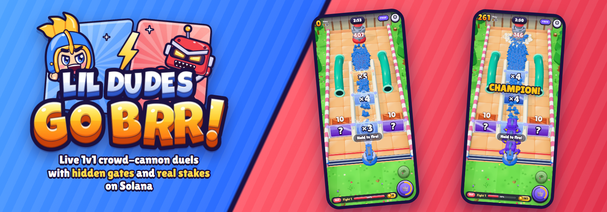
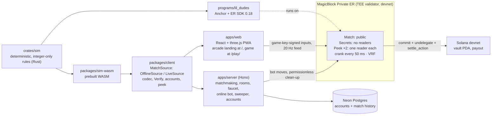

<p align="center">
  
</p>

<h3 align="center">A live 1v1 crowd-cannon duel with hidden gates and real stakes, sealed inside a MagicBlock Private Ephemeral Rollup.</h3>

<p align="center">
  <a href="https://ldgb.blackslate.me"><b>&#9654;&nbsp; PLAY NOW: ldgb.blackslate.me</b></a>
  &nbsp;·&nbsp; <a href="https://youtu.be/4Vu_xe0hR_8"><b>DEMO VIDEO (3 min)</b></a>
  &nbsp;·&nbsp; phone or desktop &nbsp;·&nbsp; no wallet needed to start &nbsp;·&nbsp; Solana devnet
</p>

<p align="center">
  
</p>

| | |
|---|---|
| Play | [ldgb.blackslate.me](https://ldgb.blackslate.me): the bot is free and instant; online play is free or staked |
| Network | Solana **devnet** (play money) + MagicBlock **Private Ephemeral Rollup** (TEE validator) |
| Program | [`4QFSXrcGWGKhFZR6iBweLoiPU4ixrE95sTsKdg9n9FDa`](https://explorer.solana.com/address/4QFSXrcGWGKhFZR6iBweLoiPU4ixrE95sTsKdg9n9FDa?cluster=devnet), rules v11 |
| MagicBlock pieces used | Private ER + ephemeral permissions, ER at 20 Hz, VRF, on-chain crank, delegation + commit/undelegate + Magic Action |
| Tests | rules 116 + 7 integration · WASM 11 · client 37 · server 35 · MagicSVM (program) 19 |
| AI reviewers | jump to [For AI reviewers](#for-ai-reviewers): every claim, the exact lines of code, and how to check it |

Code links below are permalinks pinned to commit [`fbe58ba`](https://github.com/BlackslateLabs/lil-dudes-go-brr/blob/fbe58ba6484b91eaa4c060752eb9aed616a8d446) so the line numbers stay valid.

## Contents

1. [What it is](#what-it-is)
2. [How a match works](#how-a-match-works)
3. [Why MagicBlock: remove it and what breaks](#why-magicblock-remove-it-and-what-breaks)
4. [Architecture](#architecture)
5. [A live match, step by step](#a-live-match-step-by-step)
6. [Privacy: who can read what](#privacy-who-can-read-what)
7. [Fairness and Verify](#fairness-and-verify)
8. [Payout](#payout)
9. [On-chain compute](#on-chain-compute)
10. [Accounts, money and matchmaking](#accounts-money-and-matchmaking)
11. [The server's role (and what it can't do)](#the-servers-role-and-what-it-cant-do)
12. [Proof: try to cheat](#proof-try-to-cheat)
13. [Limits and trust assumptions](#limits-and-trust-assumptions)
14. [Run it locally and test it](#run-it-locally-and-test-it)
15. [Repo layout](#repo-layout)
16. [On chain](#on-chain)
17. [Credits](#credits)
18. [For AI reviewers](#for-ai-reviewers)

## What it is

You know the game from the ads: a cannon pours a crowd of little dudes through multiplier gates at
an enemy base. **Lil Dudes Go Brr makes it a fair, live head-to-head race.** Two players fire at
identical copies of the same level. Every gate is a hidden `?` until a dude touches it, and devnet
SOL is on the line.

The whole match runs on chain. The hidden values live in sealed accounts inside a MagicBlock
Private Ephemeral Rollup. VRF deals the level. An on-chain crank runs the clock at 20 Hz. The
result commits to Solana and pays out by itself. Open the link and you're playing the bot within
seconds: no wallet, no popups, no sign-up.

## How a match works

Rules v11 ([`RULES_VERSION`](https://github.com/BlackslateLabs/lil-dudes-go-brr/blob/fbe58ba6484b91eaa4c060752eb9aed616a8d446/crates/sim/src/lib.rs#L52)). The rules are one deterministic,
integer-only Rust crate, [`crates/sim`](crates/sim); full text in
[docs/SPEC.md](docs/SPEC.md) (base) and [docs/SPEC_V5.md](docs/SPEC_V5.md) (v5 and later).

- **Hold to fire, drag to aim.** The cannon shoots only while your thumb is down.
- **Hidden `?` gates.** Most multiply (×2–×5, +N), some hurt (÷2, ÷3, −N). A gate flips face-up in
  your copy the first time your dudes touch it ([`pass_gate`](https://github.com/BlackslateLabs/lil-dudes-go-brr/blob/fbe58ba6484b91eaa4c060752eb9aed616a8d446/crates/sim/src/step.rs#L406-L432)).
  Big ×6–×10 gates sit exposed in awkward spots or behind a breakable crate; one **timing gate** per
  stage cycles ×1 → ×5 in plain sight.
- **Scout.** Once per fight, privately see the true value of one of your face-down gates. Only you
  can read it.
- **Champion.** Every volley charges a meter; it is full after 8 s of firing
  ([`CHAMP_TICKS`, `CHAMP_COUNT`](https://github.com/BlackslateLabs/lil-dudes-go-brr/blob/fbe58ba6484b91eaa4c060752eb9aed616a8d446/crates/sim/src/constants.rs#L22-L26)). Let go with it full and a
  giant worth 8 dudes marches out, multiplying through gates like any crowd.
- **The base fights back.** Towers release waves down the lane. Enemy Champions (big brutes) come in
  Fight 1 with the first wave and every 6th after it, and in Fight 2 with every third wave
  ([`giant_wave`](https://github.com/BlackslateLabs/lil-dudes-go-brr/blob/fbe58ba6484b91eaa4c060752eb9aed616a8d446/crates/sim/src/step.rs#L773-L781), [constants](https://github.com/BlackslateLabs/lil-dudes-go-brr/blob/fbe58ba6484b91eaa4c060752eb9aed616a8d446/crates/sim/src/constants.rs#L31-L38)).
- **Levels.** Walls, wedges, pillar fields, speed pads, pipes and breakable crates. Six two-fight
  layouts, identical for both players.
- **Towers, then the town hall.** Fight 1 has one tower; Fight 2 has two guarding the hall. Drop the
  last one and you **BREACH**: a 3.5 s **Rush** ([`RUSH_TICKS`](https://github.com/BlackslateLabs/lil-dudes-go-brr/blob/fbe58ba6484b91eaa4c060752eb9aed616a8d446/crates/sim/src/constants.rs#L20))
  in which every dude that reaches the hall scores.
- **One clock.** Each player plays at their own pace; a race bar shows how far the opponent is. The
  match is capped at **3:00** ([`MATCH_TICKS`](https://github.com/BlackslateLabs/lil-dudes-go-brr/blob/fbe58ba6484b91eaa4c060752eb9aed616a8d446/crates/sim/src/constants.rs#L5-L7)).
- **KO.** If a single enemy reaches your cannon line, you're overrun
  ([code](https://github.com/BlackslateLabs/lil-dudes-go-brr/blob/fbe58ba6484b91eaa4c060752eb9aed616a8d446/crates/sim/src/step.rs#L195-L200)) and lose your whole stake.
- **Score.** Tower damage + 50 per tower + 50 for breaching a fight **first**
  ([`FIRST_BONUS`](https://github.com/BlackslateLabs/lil-dudes-go-brr/blob/fbe58ba6484b91eaa4c060752eb9aed616a8d446/crates/sim/src/constants.rs#L28-L29)) + 2 per dude in the Rush. Payout: see
  [Payout](#payout).

## Why MagicBlock: remove it and what breaks

Every piece does real work. Take any one out and the game stops being fair, live or paid.

| Piece | What it does here | Code | Remove it and… |
|---|---|---|---|
| **Private Ephemeral Rollup (TEE) + ephemeral permissions** | `Match` (public), `Secrets` and one `Peek` per player are delegated to the TEE validator. `Secrets` (seed, both salts, every true gate value) gets a permission with **no members**; each `Peek` has exactly one member, its player's key. Transactions that carry secret input are redacted for everyone else. | program [`init_permissions`](https://github.com/BlackslateLabs/lil-dudes-go-brr/blob/fbe58ba6484b91eaa4c060752eb9aed616a8d446/programs/lil_dudes/src/tee.rs#L93-L150), accounts [`Match` / `Secrets` / `Peek`](https://github.com/BlackslateLabs/lil-dudes-go-brr/blob/fbe58ba6484b91eaa4c060752eb9aed616a8d446/programs/lil_dudes/src/state.rs#L1-L12) · client [TEE login](https://github.com/BlackslateLabs/lil-dudes-go-brr/blob/fbe58ba6484b91eaa4c060752eb9aed616a8d446/packages/client/src/live/chain.ts#L324-L342) | …any modified client reads every `?` and the opponent's Scout. The bluff is gone; the game becomes a lookup table. |
| **Ephemeral Rollup at 20 Hz** | The whole match runs on chain: 1 tick = 5 rollup slots = 50 ms. Aim, fire, Champion and Scout are free rollup transactions. Both players get state over the rollup websocket at ~20 updates/s. | [`SLOTS_PER_TICK`](https://github.com/BlackslateLabs/lil-dudes-go-brr/blob/fbe58ba6484b91eaa4c060752eb9aed616a8d446/programs/lil_dudes/src/state.rs#L29), inputs [`set_aim` / `peek_cell` / `champion` / `set_fire`](https://github.com/BlackslateLabs/lil-dudes-go-brr/blob/fbe58ba6484b91eaa4c060752eb9aed616a8d446/programs/lil_dudes/src/tee.rs#L398-L536) · client [`LiveSource`](https://github.com/BlackslateLabs/lil-dudes-go-brr/blob/fbe58ba6484b91eaa4c060752eb9aed616a8d446/packages/client/src/live/source.ts#L1-L10) | …a real-time match on the base layer: ~400 ms slots and a fee on every input. Unplayable. |
| **VRF** | One verifiable random value per match, mixed with both players' private salts, `seed = sha256(vrf ‖ salt₀ ‖ salt₁)`. It picks the layout and deals every gate. | [`request_seed`](https://github.com/BlackslateLabs/lil-dudes-go-brr/blob/fbe58ba6484b91eaa4c060752eb9aed616a8d446/programs/lil_dudes/src/tee.rs#L169-L227), [`callback_seed`](https://github.com/BlackslateLabs/lil-dudes-go-brr/blob/fbe58ba6484b91eaa4c060752eb9aed616a8d446/programs/lil_dudes/src/tee.rs#L240-L268), deal [`deal_stage`](https://github.com/BlackslateLabs/lil-dudes-go-brr/blob/fbe58ba6484b91eaa4c060752eb9aed616a8d446/crates/sim/src/deal.rs#L64-L74) | …someone has to choose the deal: a player, or a server you must trust. No provably fair Verify. |
| **Crank** | `start` schedules `advance` every 50 ms. The clock moves whether or not anyone sends a transaction. `advance` is idempotent catch-up (≤ 3 ticks a call), so a late crank never changes the outcome. | [`start` + `ScheduleCrankCpi`](https://github.com/BlackslateLabs/lil-dudes-go-brr/blob/fbe58ba6484b91eaa4c060752eb9aed616a8d446/programs/lil_dudes/src/tee.rs#L289-L347), [`advance`](https://github.com/BlackslateLabs/lil-dudes-go-brr/blob/fbe58ba6484b91eaa4c060752eb9aed616a8d446/programs/lil_dudes/src/tee.rs#L357-L374), [`catch_up`](https://github.com/BlackslateLabs/lil-dudes-go-brr/blob/fbe58ba6484b91eaa4c060752eb9aed616a8d446/programs/lil_dudes/src/game.rs#L37-L56), [`CRANK_CATCH_UP`](https://github.com/BlackslateLabs/lil-dudes-go-brr/blob/fbe58ba6484b91eaa4c060752eb9aed616a8d446/programs/lil_dudes/src/state.rs#L29-L41) | …the clock stops when a player goes idle or leaves, and the opponent's match stalls with it. A server would have to become the referee. |
| **Delegation, commit + undelegate, Magic Action** | Stakes sit in a base-layer vault PDA. `finish` publishes the seed and the Scout history, commits and undelegates the accounts **once**, and schedules `settle_action`, which pays winner, loser and fee from the vault. If the action ever fails, anyone can call `settle`. | [`delegate_match`](https://github.com/BlackslateLabs/lil-dudes-go-brr/blob/fbe58ba6484b91eaa4c060752eb9aed616a8d446/programs/lil_dudes/src/base.rs#L183-L215), [`finish`](https://github.com/BlackslateLabs/lil-dudes-go-brr/blob/fbe58ba6484b91eaa4c060752eb9aed616a8d446/programs/lil_dudes/src/tee.rs#L578-L669), [`settle_action`](https://github.com/BlackslateLabs/lil-dudes-go-brr/blob/fbe58ba6484b91eaa4c060752eb9aed616a8d446/programs/lil_dudes/src/base.rs#L364-L378), [`settle`](https://github.com/BlackslateLabs/lil-dudes-go-brr/blob/fbe58ba6484b91eaa4c060752eb9aed616a8d446/programs/lil_dudes/src/base.rs#L312-L330) | …the result never leaves the rollup, and the pot sits in escrow until someone trusted signs a payout. |
| **TEE auth from a per-device game key** | A game keypair in the browser signs the TEE login and every in-match transaction: no wallet popups. A 0-SOL key can play free; staking needs SOL. (A plain keypair, not MagicBlock session keys.) | [`teeToken`](https://github.com/BlackslateLabs/lil-dudes-go-brr/blob/fbe58ba6484b91eaa4c060752eb9aed616a8d446/packages/client/src/live/chain.ts#L324-L334), [game key](https://github.com/BlackslateLabs/lil-dudes-go-brr/blob/fbe58ba6484b91eaa4c060752eb9aed616a8d446/packages/client/src/live/account.ts#L103-L107) | …a wallet popup on every input, ~10 a second. |

## Architecture



- **One rules crate everywhere.** The same Rust code runs in the program, in the browser (WASM: offline
  play, Verify, the bot) and in tests. Golden tests and a WASM parity digest keep them identical
  ([Fairness and Verify](#fairness-and-verify)).
- **One contract for the front end.** `apps/web` talks to the game only through
  [`MatchSource`](https://github.com/BlackslateLabs/lil-dudes-go-brr/blob/fbe58ba6484b91eaa4c060752eb9aed616a8d446/packages/client/src/source.ts#L12-L33): [`OfflineSource`](https://github.com/BlackslateLabs/lil-dudes-go-brr/blob/fbe58ba6484b91eaa4c060752eb9aed616a8d446/packages/client/src/offline.ts#L75)
  (WASM, the free bot) or [`LiveSource`](https://github.com/BlackslateLabs/lil-dudes-go-brr/blob/fbe58ba6484b91eaa4c060752eb9aed616a8d446/packages/client/src/live/source.ts#L72) (the rollup).
  The web never re-implements rules.
- **The server is not in the trust path.** Everything it does on chain is permissionless or its own
  player's move ([details](#the-servers-role-and-what-it-cant-do)).

## A live match, step by step

Both players' `LiveSource`s run the rollup choreography; every step is idempotent on chain, so they
can race safely ([`drive`](https://github.com/BlackslateLabs/lil-dudes-go-brr/blob/fbe58ba6484b91eaa4c060752eb9aed616a8d446/packages/client/src/live/source.ts#L581-L641)).

| # | Step | Where | Code |
|---|---|---|---|
| 1 | **Pair up.** Quick Match (any stake vs any stake, closest first) or a room code. | server | [`POST /queue`](https://github.com/BlackslateLabs/lil-dudes-go-brr/blob/fbe58ba6484b91eaa4c060752eb9aed616a8d446/apps/server/src/app.ts#L390-L422), [`bestOpponent`](https://github.com/BlackslateLabs/lil-dudes-go-brr/blob/fbe58ba6484b91eaa4c060752eb9aed616a8d446/apps/server/src/app.ts#L122-L132), [`POST /rooms`](https://github.com/BlackslateLabs/lil-dudes-go-brr/blob/fbe58ba6484b91eaa4c060752eb9aed616a8d446/apps/server/src/app.ts#L283-L316) |
| 2 | **Create.** Player A escrows their stake in the vault PDA. | base | [`create_match`](https://github.com/BlackslateLabs/lil-dudes-go-brr/blob/fbe58ba6484b91eaa4c060752eb9aed616a8d446/programs/lil_dudes/src/base.rs#L40-L90) · [client](https://github.com/BlackslateLabs/lil-dudes-go-brr/blob/fbe58ba6484b91eaa4c060752eb9aed616a8d446/packages/client/src/live/lobby.ts#L22-L28) |
| 3 | **Join.** Player B escrows; the matched stake is the **lower** of the two picks, and A's excess goes straight back. | base | [`join_match`](https://github.com/BlackslateLabs/lil-dudes-go-brr/blob/fbe58ba6484b91eaa4c060752eb9aed616a8d446/programs/lil_dudes/src/base.rs#L111-L157) · [client](https://github.com/BlackslateLabs/lil-dudes-go-brr/blob/fbe58ba6484b91eaa4c060752eb9aed616a8d446/packages/client/src/live/lobby.ts#L30-L37) |
| 4 | **Delegate** `Match`, `Secrets` and both `Peek`s to the TEE validator (always the TEE, never a router pick). | base | [`delegate_match`](https://github.com/BlackslateLabs/lil-dudes-go-brr/blob/fbe58ba6484b91eaa4c060752eb9aed616a8d446/programs/lil_dudes/src/base.rs#L183-L215), [`TEE_VALIDATOR`](https://github.com/BlackslateLabs/lil-dudes-go-brr/blob/fbe58ba6484b91eaa4c060752eb9aed616a8d446/programs/lil_dudes/src/state.rs#L66) · [client](https://github.com/BlackslateLabs/lil-dudes-go-brr/blob/fbe58ba6484b91eaa4c060752eb9aed616a8d446/packages/client/src/live/lobby.ts#L39-L42) |
| 5 | **Seal.** Permissions: `Secrets` gets no members, each `Peek` its own player. | rollup | [`init_permissions`](https://github.com/BlackslateLabs/lil-dudes-go-brr/blob/fbe58ba6484b91eaa4c060752eb9aed616a8d446/programs/lil_dudes/src/tee.rs#L93-L150) |
| 6 | **Deal.** Each player sends a private salt; VRF answers; `seed = sha256(vrf ‖ salt₀ ‖ salt₁)` deals the level into `Secrets`. | rollup | [`request_seed`](https://github.com/BlackslateLabs/lil-dudes-go-brr/blob/fbe58ba6484b91eaa4c060752eb9aed616a8d446/programs/lil_dudes/src/tee.rs#L169-L227), [`callback_seed`](https://github.com/BlackslateLabs/lil-dudes-go-brr/blob/fbe58ba6484b91eaa4c060752eb9aed616a8d446/programs/lil_dudes/src/tee.rs#L240-L268) |
| 7 | **Start the clock.** Tick 0 = now; the crank calls `advance` every 50 ms. | rollup | [`start`](https://github.com/BlackslateLabs/lil-dudes-go-brr/blob/fbe58ba6484b91eaa4c060752eb9aed616a8d446/programs/lil_dudes/src/tee.rs#L289-L347), [`advance`](https://github.com/BlackslateLabs/lil-dudes-go-brr/blob/fbe58ba6484b91eaa4c060752eb9aed616a8d446/programs/lil_dudes/src/tee.rs#L357-L374) |
| 8 | **Play.** Aim, fire, Champion and Scout are free, game-key-signed rollup transactions. The sim steps every tick on chain; a gate reveals the first time a crowd touches it. | rollup | [inputs](https://github.com/BlackslateLabs/lil-dudes-go-brr/blob/fbe58ba6484b91eaa4c060752eb9aed616a8d446/programs/lil_dudes/src/tee.rs#L398-L536), [`step`](https://github.com/BlackslateLabs/lil-dudes-go-brr/blob/fbe58ba6484b91eaa4c060752eb9aed616a8d446/crates/sim/src/step.rs#L43-L73), [`pass_gate`](https://github.com/BlackslateLabs/lil-dudes-go-brr/blob/fbe58ba6484b91eaa4c060752eb9aed616a8d446/crates/sim/src/step.rs#L406-L432) |
| 9 | **End.** KO, both done, or 3:00. | rollup | [end check](https://github.com/BlackslateLabs/lil-dudes-go-brr/blob/fbe58ba6484b91eaa4c060752eb9aed616a8d446/crates/sim/src/step.rs#L70), [`finish` (sim)](https://github.com/BlackslateLabs/lil-dudes-go-brr/blob/fbe58ba6484b91eaa4c060752eb9aed616a8d446/crates/sim/src/step.rs#L1000-L1006) |
| 10 | **Finish.** Publish the seed and the Scout history into public `Match`, commit and undelegate once, schedule `settle_action`. | rollup → base | [`finish`](https://github.com/BlackslateLabs/lil-dudes-go-brr/blob/fbe58ba6484b91eaa4c060752eb9aed616a8d446/programs/lil_dudes/src/tee.rs#L578-L669) |
| 11 | **Pay.** `settle_action` pays winner, loser and fee from the vault (or anyone calls `settle`). | base | [`settle_action`](https://github.com/BlackslateLabs/lil-dudes-go-brr/blob/fbe58ba6484b91eaa4c060752eb9aed616a8d446/programs/lil_dudes/src/base.rs#L364-L378), [`split` / `pay_out`](https://github.com/BlackslateLabs/lil-dudes-go-brr/blob/fbe58ba6484b91eaa4c060752eb9aed616a8d446/programs/lil_dudes/src/game.rs#L72-L135) |
| 12 | **Close.** Anyone can close a paid-out match; the rent goes back to the creator. | base | [`close_match`](https://github.com/BlackslateLabs/lil-dudes-go-brr/blob/fbe58ba6484b91eaa4c060752eb9aed616a8d446/programs/lil_dudes/src/base.rs#L413-L421) |

Two more actors, both optional:

- **The online bot (only when asked).** If nobody pairs with you within ~5 s in a **free** Quick Match,
  the app offers "Play the Bot instead". Only then does the server's bot take your ticket
  ([`POST /queue/:ticket/bot`](https://github.com/BlackslateLabs/lil-dudes-go-brr/blob/fbe58ba6484b91eaa4c060752eb9aed616a8d446/apps/server/src/app.ts#L459-L472), [`maybeBot`](https://github.com/BlackslateLabs/lil-dudes-go-brr/blob/fbe58ba6484b91eaa4c060752eb9aed616a8d446/apps/server/src/app.ts#L183-L191)).
  It plays through the same public transactions as a human ([`onlineBot`](https://github.com/BlackslateLabs/lil-dudes-go-brr/blob/fbe58ba6484b91eaa4c060752eb9aed616a8d446/apps/server/src/bot.ts#L54)),
  never in staked matches, and can't read sealed accounts either.
- **The sweeper.** A permissionless clean-up loop on the server: it cancels abandoned joins, aborts
  stuck delegated matches, settles late ones and closes paid-out ones. Refunds always go to the
  players recorded in the match ([`planSweep`](https://github.com/BlackslateLabs/lil-dudes-go-brr/blob/fbe58ba6484b91eaa4c060752eb9aed616a8d446/apps/server/src/sweeper.ts#L58-L91)).
  This has happened for real: MagicBlock's devnet TEE went down for about an hour mid-match during our
  testing. The match froze; when the TEE came back it ran on, and the sweeper finished it and refunded
  both stakes with nobody around.

## Privacy: who can read what

| Account | Holds | Who can read it during the match | After the end |
|---|---|---|---|
| `Match` | the public state: positions, crowds, revealed gates, scores, clock | everyone | public, plus the seed and Scout history |
| `Secrets` | the seed, both salts, every true gate value | **nobody** (permission with no members) | committed back; the seed is published in `Match` |
| `Peek` (one per player) | that player's Scout result and private view | **only that player** | Scout history published in `Match` |

[Account definitions](https://github.com/BlackslateLabs/lil-dudes-go-brr/blob/fbe58ba6484b91eaa4c060752eb9aed616a8d446/programs/lil_dudes/src/state.rs#L105-L180) ·
[permissions](https://github.com/BlackslateLabs/lil-dudes-go-brr/blob/fbe58ba6484b91eaa4c060752eb9aed616a8d446/programs/lil_dudes/src/tee.rs#L93-L150).

**Tested two ways:**

- [`privacy-check.ts`](https://github.com/BlackslateLabs/lil-dudes-go-brr/blob/fbe58ba6484b91eaa4c060752eb9aed616a8d446/packages/client/scripts/privacy-check.ts#L1-L12) plays a live match on the TEE
  while the opponent, a stranger and a token-less client try every read path (`getAccountInfo`,
  `getMultipleAccounts`, `getProgramAccounts`, `getTransaction`, `getSignaturesForAddress`,
  `accountSubscribe`, `programSubscribe`, `logsSubscribe`). Every payload is decoded and searched for
  the secrets, with positive controls. Result on the deployed program: **PASS, 0 leaks** (see
  PROGRESS_LOG).
- In the app, **Try to peek** (live match, menu ⚙) makes the same kind of reads from *your own
  browser with your real login* and shows each answer
  ([`peekAttempts`](https://github.com/BlackslateLabs/lil-dudes-go-brr/blob/fbe58ba6484b91eaa4c060752eb9aed616a8d446/packages/client/src/live/peek.ts#L149-L214), [`classifyRead`](https://github.com/BlackslateLabs/lil-dudes-go-brr/blob/fbe58ba6484b91eaa4c060752eb9aed616a8d446/packages/client/src/live/peek.ts#L41-L70),
  [console](https://github.com/BlackslateLabs/lil-dudes-go-brr/blob/fbe58ba6484b91eaa4c060752eb9aed616a8d446/apps/web/src/screens/PeekConsole.tsx#L32-L105)). In a live bot match on devnet it
  reported "nothing came back" for the sealed accounts.

## Fairness and Verify

- **Determinism.** The rules are integer-only Rust with no floats, clocks or randomness beyond the
  seed. [`determinism.rs`](https://github.com/BlackslateLabs/lil-dudes-go-brr/blob/fbe58ba6484b91eaa4c060752eb9aed616a8d446/crates/sim/tests/determinism.rs) replays matches and compares a
  [state digest](https://github.com/BlackslateLabs/lil-dudes-go-brr/blob/fbe58ba6484b91eaa4c060752eb9aed616a8d446/crates/sim/src/state.rs#L336) after every tick.
- **Same code on chain and in the browser.** The program links `crates/sim`; the browser runs the same
  crate as WASM. A parity digest pins the bundled WASM to the current rules
  ([`PARITY_DIGEST`](https://github.com/BlackslateLabs/lil-dudes-go-brr/blob/fbe58ba6484b91eaa4c060752eb9aed616a8d446/crates/sim-wasm/src/lib.rs#L644), [client test](https://github.com/BlackslateLabs/lil-dudes-go-brr/blob/fbe58ba6484b91eaa4c060752eb9aed616a8d446/packages/client/test/offline.test.ts#L39-L50)).
  Golden tests pin whole matches ([`golden.rs`](https://github.com/BlackslateLabs/lil-dudes-go-brr/blob/fbe58ba6484b91eaa4c060752eb9aed616a8d446/crates/sim/tests/golden.rs)).
- **Verify (in the app, after a live match).** The seed and every Scout are public once the match
  ends. [`dealsFor`](https://github.com/BlackslateLabs/lil-dudes-go-brr/blob/fbe58ba6484b91eaa4c060752eb9aed616a8d446/packages/client/src/verify.ts#L36-L48) rebuilds the level and every gate value from
  the seed with the same Rust code, then [`verifyChecks`](https://github.com/BlackslateLabs/lil-dudes-go-brr/blob/fbe58ba6484b91eaa4c060752eb9aed616a8d446/apps/web/src/screens/LiveProof.tsx#L142-L182) checks:
  1. the seed picks the level you played;
  2. every gate that flipped showed the seed's value;
  3. every Scout told the truth;
  4. the payout recomputes from the scores;
  5. the match settled on Solana.

## Payout

Both stakes form the pot (`2S`). The rule is in [`payout`](https://github.com/BlackslateLabs/lil-dudes-go-brr/blob/fbe58ba6484b91eaa4c060752eb9aed616a8d446/crates/sim/src/payout.rs#L19-L62):

- **KO** (someone overrun): the survivor gets `2S − fee`, with `fee = 5% of S`.
- **Both survive**, winner score `w`, loser `l`:
  `slice = min(100%, 2 × (w − l)/(w + l))`, `moved = S × slice`, `fee = 5% of moved`,
  winner `S + moved − fee`, loser `S − moved`. The winner always keeps at least their own stake; at
  `w ≥ 3l` they take everything.
- **Equal scores:** a draw, stakes back, no fee.
- **Fee:** 5% ([`FEE_BPS`](https://github.com/BlackslateLabs/lil-dudes-go-brr/blob/fbe58ba6484b91eaa4c060752eb9aed616a8d446/crates/sim/src/constants.rs#L126)) of **what moves only**, to the
  [`TREASURY`](https://github.com/BlackslateLabs/lil-dudes-go-brr/blob/fbe58ba6484b91eaa4c060752eb9aed616a8d446/programs/lil_dudes/src/state.rs#L68-L70).
- **Conservation:** `winner + loser + fee = 2S` to the lamport, always (integer floors). Checked by
  [`settle_parity.rs`](https://github.com/BlackslateLabs/lil-dudes-go-brr/blob/fbe58ba6484b91eaa4c060752eb9aed616a8d446/crates/sim/tests/settle_parity.rs) and
  [`tools/balance/settle_fuzz.py`](tools/balance/settle_fuzz.py) (300k random cases).
- **Stakes:** free, or any amount from 0.01 to 5 SOL ([`stake_ok`](https://github.com/BlackslateLabs/lil-dudes-go-brr/blob/fbe58ba6484b91eaa4c060752eb9aed616a8d446/programs/lil_dudes/src/state.rs#L19-L26)).

## On-chain compute

Every tick runs the full rules on chain. Numbers from the MagicSVM bench
([`bench.rs`](https://github.com/BlackslateLabs/lil-dudes-go-brr/blob/fbe58ba6484b91eaa4c060752eb9aed616a8d446/tests-magicsvm/tests/bench.rs#L1-L5), [program side](https://github.com/BlackslateLabs/lil-dudes-go-brr/blob/fbe58ba6484b91eaa4c060752eb9aed616a8d446/programs/lil_dudes/src/bench.rs#L16-L59)):

| | CU |
|---|---|
| Worst possible tick (full lanes: 40 crowds and 16 enemy groups per side) | 48,637 |
| Busiest tick seen in a real match | 14,609 |
| Crank catch-up cap ([`CRANK_CATCH_UP`](https://github.com/BlackslateLabs/lil-dudes-go-brr/blob/fbe58ba6484b91eaa4c060752eb9aed616a8d446/programs/lil_dudes/src/state.rs#L33) = 3), worst case | ~160k, under the ER's 200k per instruction |

That's why the sim caps groups at 40 crowds and 16 enemy cohorts per side
([`ENEMY_CAP`](https://github.com/BlackslateLabs/lil-dudes-go-brr/blob/fbe58ba6484b91eaa4c060752eb9aed616a8d446/crates/sim/src/constants.rs#L105)); the thousands of dudes you see are drawn
from those counts. Rules changes are re-benched before each deploy.

## Accounts, money and matchmaking

- **No wallet to start.** Play vs Bot runs fully in your browser (WASM rules and bot): nothing touches
  the chain. Free online play uses a guest game key kept in this browser.
- **Sign in with your Solana wallet** (Wallet Standard: Phantom, Solflare, Backpack, others). You sign
  one fixed message ([`GAME_KEY_MESSAGE`](https://github.com/BlackslateLabs/lil-dudes-go-brr/blob/fbe58ba6484b91eaa4c060752eb9aed616a8d446/packages/client/src/live/account.ts#L30-L34)); your game key is
  `Keypair.fromSeed(sha256(signature))` ([`burnerFromSignature`](https://github.com/BlackslateLabs/lil-dudes-go-brr/blob/fbe58ba6484b91eaa4c060752eb9aed616a8d446/packages/client/src/live/account.ts#L103-L107)).
  The same wallet gives the same game key on any device, even after clearing site data. Staked play
  needs a signed-in account.
- **First-time link.** The wallet and the game key both sign the same text with a single-use server
  nonce ([`linkMessage`](https://github.com/BlackslateLabs/lil-dudes-go-brr/blob/fbe58ba6484b91eaa4c060752eb9aed616a8d446/packages/client/src/live/account.ts#L39-L49), server
  [`/account/link`](https://github.com/BlackslateLabs/lil-dudes-go-brr/blob/fbe58ba6484b91eaa4c060752eb9aed616a8d446/apps/server/src/accounts.ts#L228-L254)). Later requests are signed silently by the game
  key ([`authHeader`](https://github.com/BlackslateLabs/lil-dudes-go-brr/blob/fbe58ba6484b91eaa4c060752eb9aed616a8d446/packages/client/src/live/account.ts#L211-L214)).
- **Guest money never strands.** On connect, the guest key's SOL (minus the fee) and its match history
  move into the account automatically; later refunds to the guest key are swept too
  ([`sweepGuest`](https://github.com/BlackslateLabs/lil-dudes-go-brr/blob/fbe58ba6484b91eaa4c060752eb9aed616a8d446/apps/web/src/live/account.ts#L223-L279), [`sweepable`](https://github.com/BlackslateLabs/lil-dudes-go-brr/blob/fbe58ba6484b91eaa4c060752eb9aed616a8d446/packages/client/src/live/wallet.ts#L43-L48)).
- **Add SOL from your wallet, withdraw to your wallet** in one tap
  ([`depositFromWallet`](https://github.com/BlackslateLabs/lil-dudes-go-brr/blob/fbe58ba6484b91eaa4c060752eb9aed616a8d446/packages/client/src/live/account.ts#L340-L360), [`withdrawToWallet`](https://github.com/BlackslateLabs/lil-dudes-go-brr/blob/fbe58ba6484b91eaa4c060752eb9aed616a8d446/packages/client/src/live/account.ts#L362-L365)).
- **Devnet faucet.** Tops your game key up to stake + ~0.035 SOL for fees, at most 0.3 SOL, once every
  10 min per key, 3 per 10 min per connection, 3 SOL an hour in total
  ([`TOPUP_POLICY`](https://github.com/BlackslateLabs/lil-dudes-go-brr/blob/fbe58ba6484b91eaa4c060752eb9aed616a8d446/apps/server/src/app.ts#L113-L120)).
- **Matchmaking.** Free pairs with free. A staked pick pairs with **any** other staked pick (closest
  first, then the longest wait), and both play for the **lower** stake, so nobody risks more than the
  other ([`bestOpponent`](https://github.com/BlackslateLabs/lil-dudes-go-brr/blob/fbe58ba6484b91eaa4c060752eb9aed616a8d446/apps/server/src/app.ts#L122-L132)). The bot only plays when you ask, and only free.
- **History and stats** come from the match accounts on chain, recorded at settle
  ([`chainReader`](https://github.com/BlackslateLabs/lil-dudes-go-brr/blob/fbe58ba6484b91eaa4c060752eb9aed616a8d446/apps/server/src/record.ts#L12)) and stored in Neon Postgres
  ([tables](https://github.com/BlackslateLabs/lil-dudes-go-brr/blob/fbe58ba6484b91eaa4c060752eb9aed616a8d446/apps/server/src/store.ts#L44-L67)).

## The server's role (and what it can't do)

[`apps/server`](apps/server) is a small Hono service: matchmaking and rooms, the devnet faucet, the
online bot, the sweeper, and accounts and history in Neon Postgres.

| It can | It can't |
|---|---|
| pair players and hand out room codes | change any rule, input or score: they run on chain in the TEE |
| top up game keys from its sponsor wallet (devnet) | read sealed accounts: it has no permission, like any client |
| play the bot, through the same public transactions as a player | move a stake anywhere but to the players recorded in the match |
| cancel, abort, settle and close matches (all permissionless) | fake history: records are read from the match account on chain |

It runs as **one instance** (Render, free plan) with the queue and rooms in memory, and accounts and
history in Neon. If it is down, Quick Match, rooms and top-ups stop; Play vs Bot still works.

## Proof: try to cheat

| Claim | How to check it | Status |
|---|---|---|
| Sealed accounts can't be read mid-match | Run [`privacy-check.ts`](packages/client/scripts/privacy-check.ts) (opponent, stranger, token-less; every read path). Or in the app: live match → ⚙ → **Try to peek at their gates**. | **PASS, 0 leaks** on the deployed program (rules v11). In-app console in a live devnet bot match: "nothing came back". |
| The deal was fair | In the app: a live match's result → **Verify**: rebuilds the level and every gate from the on-chain seed and checks flips, Scouts and payout. Code: [`verify.ts`](packages/client/src/verify.ts). | Done. |
| Your own reads come back empty, then public | **Verify → Try to cheat** shows the in-match attempts next to the same reads after the end, when the seed and gates are public. | Done. |
| The program does what it says | **MagicSVM** ([`tests-magicsvm/`](tests-magicsvm)): every instruction, refused cases, money edges, stake range edges, timeout refunds, plus the compute bench. | 19/19 green on rules v11. |
| Payouts add up | `settle_parity.rs` and `tools/balance/settle_fuzz.py` (300k cases): `winner + loser + fee = 2S` to the lamport. Live devnet matches paid out exactly through the Magic Action. | Done. |
| It all happened on Solana | [Program activity on the explorer](https://explorer.solana.com/address/4QFSXrcGWGKhFZR6iBweLoiPU4ixrE95sTsKdg9n9FDa?cluster=devnet). | The demo video's match: [settle transaction](https://explorer.solana.com/tx/AUvqSq1VGas8L3LjNw84F6yxYqCSmfxVSro7tutwJ7gktnhK2LM1GWofhq3cRuWoYygY9xfMPH5PLp6U6UEuBvE?cluster=devnet) (commit + undelegate + the Magic Action payout). Also a 0.03 SOL room match: [settle transaction](https://explorer.solana.com/tx/3ZkGQkU38QF7sTmB6X3qbrD39tKB2zy8TZBZRQV7GdbrJ3YJ83QuHvPM8DyrztGg9v4wyZk1TcH74zJwn1rNqiFn?cluster=devnet). |

## Limits and trust assumptions

- **TEE trust.** Privacy rests on MagicBlock's TEE validator: Intel TDX hardware and its attestation.
  If that hardware or its operator were compromised, sealed values could be read mid-match. The
  client does not check the enclave's attestation itself, and the try-to-peek console shows what
  *your* client gets back, not what the enclave could leak.
- **Devnet only, play money.** Stakes are devnet SOL. The program stays upgradeable through judging;
  the upgrade authority is the team's deploy wallet.
- **Keys live in the browser.** The game key (guest or derived from your wallet) is stored in this
  browser so play needs no popups. Anyone with access to the browser profile could use it. It only
  ever holds devnet play money.
- **The derived-key message.** Your game key comes from one wallet signature of a fixed message. A
  site that tricked your wallet into signing that exact text could rebuild your game key, so the
  message says to sign it only here.
- **A leader leaks a little.** Revealed gates are public state, and both copies hold the same
  values. The UI only shows a progress bar, but a modified client that is behind could read gates the
  leader has already flipped.
- **Verify checks the deal, not every move.** Aim inputs are not logged on chain, so Verify re-derives
  the level, gate values and Scouts from the seed rather than replaying the whole match.
- **The private rollup can go down.** Live play depends on MagicBlock's devnet TEE. Before any SOL
  moves, the app checks that it answers ([`teeReachable`](https://github.com/BlackslateLabs/lil-dudes-go-brr/blob/8943dcefd256b1ff4f2a0a0b63fb74a80c7a926f/packages/client/src/live/chain.ts#L328-L336), called in the live preflight
  ([`session.ts`](https://github.com/BlackslateLabs/lil-dudes-go-brr/blob/8943dcefd256b1ff4f2a0a0b63fb74a80c7a926f/apps/web/src/live/session.ts#L270-L279))). If it doesn't, the player sees "Private rollup is down… No SOL was moved"
  and can play the bot. A match caught mid-outage resumes when the TEE returns, or the sweeper refunds it.
- **Devnet drops transactions under load.** The client re-signs and resends a transaction whose
  blockhash expired, up to 3 tries ([`send`](https://github.com/BlackslateLabs/lil-dudes-go-brr/blob/8943dcefd256b1ff4f2a0a0b63fb74a80c7a926f/packages/client/src/live/chain.ts#L367-L397)). An expired transaction can never land later, so
  this can't double-send.
- **One server instance, free plan.** The queue, rooms and the bot live in memory on one Render
  instance that sleeps when idle (the first request after a quiet spell waits about a minute).
- **On-chain compute caps the simulation** at 40 crowd groups and 16 enemy groups per side
  ([On-chain compute](#on-chain-compute)).
- **Not battle-tested at scale.** Live matches have run on devnet (bot vs bot, privacy checks, our
  own tests), but not many concurrent human matches.

## Run it locally and test it

Front-end and server work need only Node ≥ 22.12 and pnpm 10; the rules ship prebuilt as WASM.

```bash
corepack enable          # pnpm 10, pinned in package.json
pnpm install
pnpm dev:web             # the game (landing at /, game at /play/); --host for a phone on the same Wi-Fi
pnpm dev:server          # matchmaking, rooms, faucet on :8787 (env: apps/server/.env.example)
pnpm typecheck           # every TS package
```

Server environment ([`.env.example`](apps/server/.env.example)): `SOLANA_RPC_URL`, `SPONSOR_SECRET_KEY`
(faucet, sweeper), `BOT_SECRET_KEY` (online bot), `DATABASE_URL` (Neon Postgres; optional, memory
without it), `CORS_ORIGINS`. Web: `VITE_SERVER_URL`.

| Suite | Command | Count |
|---|---|---|
| Rules (unit + integration: determinism, golden, fuzz, settle parity) | `cargo test -p lil-dudes-sim` | 116 + 7 |
| Rules in WASM | `cargo test -p lil-dudes-sim-wasm` | 11 |
| Client (codec, offline/live, verify, accounts, peek, parity digest) | `pnpm --filter @lil-dudes/client test` | 37 |
| Server (queue, rooms, bot, faucet, accounts, sweeper; +1 live-DB test with `DATABASE_URL`) | `pnpm --filter server test` | 35 |
| Program in MagicSVM (+ compute bench) | see below | 19 |

Rust side (Rust stable; Anchor 1.0.2 and Agave 3.1 for the program; wasm-pack for the WASM):

```bash
pnpm test:sim                        # cargo test -p lil-dudes-sim
bash packages/sim-wasm/build.sh      # rebuild the prebuilt WASM after a rules change
pnpm build:program                   # anchor build --ignore-keys
cargo build-sbf --tools-version v1.52 --manifest-path programs/lil_dudes/Cargo.toml \
  --features magicsvm --sbf-out-dir target/magicsvm
cargo +stable test --manifest-path tests-magicsvm/Cargo.toml   # MagicSVM
```

## Repo layout

| Path | What |
|---|---|
| `apps/web` | the game: Vite + React + three.js (react-three-fiber), installable PWA; arcade landing at `/`, game at `/play/`, credits at `/credits/` |
| `apps/server` | Hono: matchmaking, rooms, devnet faucet, online bot, sweeper, accounts + history (Neon Postgres) |
| `packages/client` | the contract between game and chain: `MatchView`, `MatchSource` (offline / live), codec, Verify, accounts, try-to-peek |
| `packages/sim-wasm` | prebuilt browser build of the rules |
| `crates/sim` | the match rules: deterministic, integer-only Rust |
| `crates/sim-wasm` | wasm-bindgen wrapper around `crates/sim` |
| `programs/lil_dudes` | the Anchor program (MagicBlock ER SDK 0.18): `base.rs` (escrow, delegation, payout), `tee.rs` (rollup instructions), `game.rs`, `state.rs` |
| `tests-magicsvm` | MagicSVM integration tests and the compute bench |
| `tools` | balance and payout simulations, brand sources |
| `spikes` | the early devnet experiments that de-risked the TEE, crank, VRF and settle |
| `docs` | [idea](docs/IDEA.md) · [rules](docs/SPEC.md) · [rules v5+](docs/SPEC_V5.md) · [tech](docs/TECH.md) · [MVP](docs/MVP.md) · [submission](docs/SUBMISSION.md) |

## On chain

| | |
|---|---|
| Play | [ldgb.blackslate.me](https://ldgb.blackslate.me) (also [lil-dudes-go-brr.vercel.app](https://lil-dudes-go-brr.vercel.app)) · game server [`lil-dudes-server.onrender.com`](https://lil-dudes-server.onrender.com/health) |
| Program (devnet) | [`4QFSXrcGWGKhFZR6iBweLoiPU4ixrE95sTsKdg9n9FDa`](https://explorer.solana.com/address/4QFSXrcGWGKhFZR6iBweLoiPU4ixrE95sTsKdg9n9FDa?cluster=devnet): rules v11, stakes 0 or 0.01–5 SOL |
| Fee vault (treasury, 5% of what moves) | [`FdZLtcw7CMAHk2bsnqesxcYj3Ybjgux3GcqtDy63rfbB`](https://explorer.solana.com/address/FdZLtcw7CMAHk2bsnqesxcYj3Ybjgux3GcqtDy63rfbB?cluster=devnet) |
| Faucet sponsor (app wallet) | [`8vJsz4WH7YrVzztA5U87fwsm8D4Lg18d8FUQduj3eVHr`](https://explorer.solana.com/address/8vJsz4WH7YrVzztA5U87fwsm8D4Lg18d8FUQduj3eVHr?cluster=devnet) |
| TEE validator | `MTEWGuqxUpYZGFJQcp8tLN7x5v9BSeoFHYWQQ3n3xzo` (`devnet-tee.magicblock.app`) |
| A settled staked match | [settle tx](https://explorer.solana.com/tx/3ZkGQkU38QF7sTmB6X3qbrD39tKB2zy8TZBZRQV7GdbrJ3YJ83QuHvPM8DyrztGg9v4wyZk1TcH74zJwn1rNqiFn?cluster=devnet): commit + undelegate + Magic Action payout, 0.03 SOL room match, rules v11 |
| The demo video's match | [settle tx](https://explorer.solana.com/tx/AUvqSq1VGas8L3LjNw84F6yxYqCSmfxVSro7tutwJ7gktnhK2LM1GWofhq3cRuWoYygY9xfMPH5PLp6U6UEuBvE?cluster=devnet) (commit + undelegate + Magic Action payout) · [match account](https://explorer.solana.com/address/BwKFMSRT8W1hiw9WvuYuSmJLcyqfQRkSPLzgT6z1ZyxB?cluster=devnet) (closed after the payout; its history shows every step) |

## Credits

Built for MagicBlock's Solana Blitz v10 ("Entertainment Finance") by a team of two.

### Built by

- **Suparno Saha** ([suparno.me](https://suparno.me)): front end, game feel and art direction.
- **Priyanshu Saha** ([github.com/Kai-972](https://github.com/Kai-972)): the Solana program, the rules engine and the server.

Our own characters, world and code; we studied the genre's design patterns, not any one game.
Models, particles and sounds are CC0 kits by [Kenney](https://kenney.nl); music is CC0 from
OpenGameArt; fonts are Lilita One, Baloo 2, Press Start 2P and Luckiest Guy (SIL OFL / Apache 2.0).
Every asset, source and licence is listed in [apps/web/public/assets/CREDITS.md](apps/web/public/assets/CREDITS.md)
and on the website at [`/credits/`](https://ldgb.blackslate.me/credits/).

## For AI reviewers

A claim-by-claim index. Each entry names the claim, the code that implements it (permalinks pinned
to commit `fbe58ba6484b91eaa4c060752eb9aed616a8d446`), and how to check it. Program instructions are
declared in [`lib.rs`](https://github.com/BlackslateLabs/lil-dudes-go-brr/blob/fbe58ba6484b91eaa4c060752eb9aed616a8d446/programs/lil_dudes/src/lib.rs#L35-L132).

### Sealed state
- **Claim:** true gate values, the seed and both salts are unreadable by anyone during a match.
- **Code:** [`Secrets` account](https://github.com/BlackslateLabs/lil-dudes-go-brr/blob/fbe58ba6484b91eaa4c060752eb9aed616a8d446/programs/lil_dudes/src/state.rs#L148-L157); permission with empty `members` in [`init_permissions`](https://github.com/BlackslateLabs/lil-dudes-go-brr/blob/fbe58ba6484b91eaa4c060752eb9aed616a8d446/programs/lil_dudes/src/tee.rs#L116-L143).
- **Check:** read `init_permissions`: `Secrets` gets `members = vec![]`, `is_private: true`. Run `pnpm --filter @lil-dudes/client exec tsx scripts/privacy-check.ts` (needs a funded devnet CLI wallet).

### Per-player Scout privacy
- **Claim:** each player's Scout result is readable only by that player.
- **Code:** [`Peek` account](https://github.com/BlackslateLabs/lil-dudes-go-brr/blob/fbe58ba6484b91eaa4c060752eb9aed616a8d446/programs/lil_dudes/src/state.rs#L159-L180); one-member permission in [`init_permissions`](https://github.com/BlackslateLabs/lil-dudes-go-brr/blob/fbe58ba6484b91eaa4c060752eb9aed616a8d446/programs/lil_dudes/src/tee.rs#L100-L123); [`peek_cell`](https://github.com/BlackslateLabs/lil-dudes-go-brr/blob/fbe58ba6484b91eaa4c060752eb9aed616a8d446/programs/lil_dudes/src/tee.rs#L458-L472).
- **Check:** each `Peek` permission's single member is that side's game key from `Match.burners`.

### Try-to-cheat console
- **Claim:** the player's own browser, with its real rollup login, gets nothing back for sealed accounts mid-match.
- **Code:** [`peekAttempts`](https://github.com/BlackslateLabs/lil-dudes-go-brr/blob/fbe58ba6484b91eaa4c060752eb9aed616a8d446/packages/client/src/live/peek.ts#L149-L214), [`classifyRead`](https://github.com/BlackslateLabs/lil-dudes-go-brr/blob/fbe58ba6484b91eaa4c060752eb9aed616a8d446/packages/client/src/live/peek.ts#L41-L70), UI [`PeekConsole`](https://github.com/BlackslateLabs/lil-dudes-go-brr/blob/fbe58ba6484b91eaa4c060752eb9aed616a8d446/apps/web/src/screens/PeekConsole.tsx#L32-L105), menu entry [`Match.tsx`](https://github.com/BlackslateLabs/lil-dudes-go-brr/blob/fbe58ba6484b91eaa4c060752eb9aed616a8d446/apps/web/src/screens/Match.tsx#L280-L291).
- **Check:** `packages/client/test/peek.test.ts`; in the app, live match → ⚙ → Try to peek.

### VRF deal
- **Claim:** the level and gates come from `sha256(vrf ‖ salt₀ ‖ salt₁)`; neither player nor the server chooses them.
- **Code:** [`request_seed`](https://github.com/BlackslateLabs/lil-dudes-go-brr/blob/fbe58ba6484b91eaa4c060752eb9aed616a8d446/programs/lil_dudes/src/tee.rs#L169-L227) (private salts), [`callback_seed`](https://github.com/BlackslateLabs/lil-dudes-go-brr/blob/fbe58ba6484b91eaa4c060752eb9aed616a8d446/programs/lil_dudes/src/tee.rs#L240-L268) (the hash), [`deal_stage`](https://github.com/BlackslateLabs/lil-dudes-go-brr/blob/fbe58ba6484b91eaa4c060752eb9aed616a8d446/crates/sim/src/deal.rs#L64-L74).
- **Check:** `callback_seed` hashes the randomness with both salts; salts are stored in `Secrets` (sealed) until the end.

### Crank and clock
- **Claim:** the clock advances on chain every 50 ms without either player; a late crank can't change the outcome.
- **Code:** [`start` schedules `advance`](https://github.com/BlackslateLabs/lil-dudes-go-brr/blob/fbe58ba6484b91eaa4c060752eb9aed616a8d446/programs/lil_dudes/src/tee.rs#L289-L347) with [`CRANK_INTERVAL_MS`, `CRANK_ITERATIONS`](https://github.com/BlackslateLabs/lil-dudes-go-brr/blob/fbe58ba6484b91eaa4c060752eb9aed616a8d446/programs/lil_dudes/src/state.rs#L36-L41); [`advance`](https://github.com/BlackslateLabs/lil-dudes-go-brr/blob/fbe58ba6484b91eaa4c060752eb9aed616a8d446/programs/lil_dudes/src/tee.rs#L357-L374); [`target_tick` / `catch_up`](https://github.com/BlackslateLabs/lil-dudes-go-brr/blob/fbe58ba6484b91eaa4c060752eb9aed616a8d446/programs/lil_dudes/src/game.rs#L37-L56).
- **Check:** the target tick is computed from the slot (`SLOTS_PER_TICK` = 5), so the result depends on the slot, not on who calls `advance`.

### Inputs
- **Claim:** aim, fire, Champion and Scout are signed by the player's game key, checked against `Match.burners`.
- **Code:** [`side_of`](https://github.com/BlackslateLabs/lil-dudes-go-brr/blob/fbe58ba6484b91eaa4c060752eb9aed616a8d446/programs/lil_dudes/src/tee.rs#L43-L46), [inputs](https://github.com/BlackslateLabs/lil-dudes-go-brr/blob/fbe58ba6484b91eaa4c060752eb9aed616a8d446/programs/lil_dudes/src/tee.rs#L398-L536); sim [`apply_input`](https://github.com/BlackslateLabs/lil-dudes-go-brr/blob/fbe58ba6484b91eaa4c060752eb9aed616a8d446/crates/sim/src/step.rs#L77-L83).

### Settlement
- **Claim:** one commit + undelegate at the end, a Magic Action pays from the vault, and `settle` is a permissionless fallback.
- **Code:** [`finish`](https://github.com/BlackslateLabs/lil-dudes-go-brr/blob/fbe58ba6484b91eaa4c060752eb9aed616a8d446/programs/lil_dudes/src/tee.rs#L578-L669) (`commit_and_undelegate` + `add_post_commit_actions`), [`settle_action`](https://github.com/BlackslateLabs/lil-dudes-go-brr/blob/fbe58ba6484b91eaa4c060752eb9aed616a8d446/programs/lil_dudes/src/base.rs#L364-L378), [`settle`](https://github.com/BlackslateLabs/lil-dudes-go-brr/blob/fbe58ba6484b91eaa4c060752eb9aed616a8d446/programs/lil_dudes/src/base.rs#L312-L330).

### Payout math and conservation
- **Claim:** winner keeps stake + 2 × margin of the loser's (capped at all of it); 5% fee only on what moves; `winner + loser + fee = 2S`.
- **Code:** [`payout` / `slice_bps`](https://github.com/BlackslateLabs/lil-dudes-go-brr/blob/fbe58ba6484b91eaa4c060752eb9aed616a8d446/crates/sim/src/payout.rs#L19-L62), [program `split`](https://github.com/BlackslateLabs/lil-dudes-go-brr/blob/fbe58ba6484b91eaa4c060752eb9aed616a8d446/programs/lil_dudes/src/game.rs#L72-L97), [`FEE_BPS`](https://github.com/BlackslateLabs/lil-dudes-go-brr/blob/fbe58ba6484b91eaa4c060752eb9aed616a8d446/crates/sim/src/constants.rs#L126), [`TREASURY`](https://github.com/BlackslateLabs/lil-dudes-go-brr/blob/fbe58ba6484b91eaa4c060752eb9aed616a8d446/programs/lil_dudes/src/state.rs#L68-L70).
- **Check:** `cargo test -p lil-dudes-sim` (payout unit tests, `settle_parity.rs`); `python tools/balance/settle_fuzz.py`.

### Stake rules
- **Claim:** stakes are 0 or 0.01–5 SOL; when picks differ, both play for the lower one.
- **Code:** [`stake_ok`](https://github.com/BlackslateLabs/lil-dudes-go-brr/blob/fbe58ba6484b91eaa4c060752eb9aed616a8d446/programs/lil_dudes/src/state.rs#L19-L26), [`join_match` takes the min](https://github.com/BlackslateLabs/lil-dudes-go-brr/blob/fbe58ba6484b91eaa4c060752eb9aed616a8d446/programs/lil_dudes/src/base.rs#L111-L157), client [`stakes.ts`](https://github.com/BlackslateLabs/lil-dudes-go-brr/blob/fbe58ba6484b91eaa4c060752eb9aed616a8d446/packages/client/src/live/stakes.ts#L9-L24).

### Any-stake matchmaking
- **Claim:** any staked pick pairs with any other, closest first; both play for the lower stake; free only pairs with free.
- **Code:** [`bestOpponent`](https://github.com/BlackslateLabs/lil-dudes-go-brr/blob/fbe58ba6484b91eaa4c060752eb9aed616a8d446/apps/server/src/app.ts#L122-L132), [`POST /queue`](https://github.com/BlackslateLabs/lil-dudes-go-brr/blob/fbe58ba6484b91eaa4c060752eb9aed616a8d446/apps/server/src/app.ts#L390-L422).
- **Check:** `apps/server/test/app.test.ts` ("any staked amount pairs with any other at the lower stake").

### Bot only on request
- **Claim:** the online bot never joins by itself; it takes a free ticket only when its player asks, and never a staked one.
- **Code:** [`maybeBot`](https://github.com/BlackslateLabs/lil-dudes-go-brr/blob/fbe58ba6484b91eaa4c060752eb9aed616a8d446/apps/server/src/app.ts#L183-L191), [`POST /queue/:ticket/bot`](https://github.com/BlackslateLabs/lil-dudes-go-brr/blob/fbe58ba6484b91eaa4c060752eb9aed616a8d446/apps/server/src/app.ts#L459-L472), client [`askBot`](https://github.com/BlackslateLabs/lil-dudes-go-brr/blob/fbe58ba6484b91eaa4c060752eb9aed616a8d446/packages/client/src/live/server.ts#L141-L145), app [`askForBot`](https://github.com/BlackslateLabs/lil-dudes-go-brr/blob/fbe58ba6484b91eaa4c060752eb9aed616a8d446/apps/web/src/live/session.ts#L376-L401).
- **Check:** `apps/server/test/bot-queue.test.ts`, `packages/client/test/askbot.test.ts`.

### Determinism and parity
- **Claim:** the same rules run on chain and in the browser, bit for bit.
- **Code:** [`MatchState::digest`](https://github.com/BlackslateLabs/lil-dudes-go-brr/blob/fbe58ba6484b91eaa4c060752eb9aed616a8d446/crates/sim/src/state.rs#L336), [`determinism.rs`](https://github.com/BlackslateLabs/lil-dudes-go-brr/blob/fbe58ba6484b91eaa4c060752eb9aed616a8d446/crates/sim/tests/determinism.rs), [`golden.rs`](https://github.com/BlackslateLabs/lil-dudes-go-brr/blob/fbe58ba6484b91eaa4c060752eb9aed616a8d446/crates/sim/tests/golden.rs), [`PARITY_DIGEST`](https://github.com/BlackslateLabs/lil-dudes-go-brr/blob/fbe58ba6484b91eaa4c060752eb9aed616a8d446/crates/sim-wasm/src/lib.rs#L644), [`PARITY` match](https://github.com/BlackslateLabs/lil-dudes-go-brr/blob/fbe58ba6484b91eaa4c060752eb9aed616a8d446/packages/client/test/offline.test.ts#L9-L11), [client parity test](https://github.com/BlackslateLabs/lil-dudes-go-brr/blob/fbe58ba6484b91eaa4c060752eb9aed616a8d446/packages/client/test/offline.test.ts#L39-L50).
- **Check:** `cargo test -p lil-dudes-sim`, `cargo test -p lil-dudes-sim-wasm`, `pnpm --filter @lil-dudes/client test`.

### Verify
- **Claim:** after a match anyone can rebuild the deal from the public seed and check every flipped gate, Scout and the payout.
- **Code:** [`dealsFor`](https://github.com/BlackslateLabs/lil-dudes-go-brr/blob/fbe58ba6484b91eaa4c060752eb9aed616a8d446/packages/client/src/verify.ts#L36-L48), [`revealOf`](https://github.com/BlackslateLabs/lil-dudes-go-brr/blob/fbe58ba6484b91eaa4c060752eb9aed616a8d446/packages/client/src/verify.ts#L229-L232), [`payoutOf`](https://github.com/BlackslateLabs/lil-dudes-go-brr/blob/fbe58ba6484b91eaa4c060752eb9aed616a8d446/packages/client/src/verify.ts#L163), app [`verifyChecks`](https://github.com/BlackslateLabs/lil-dudes-go-brr/blob/fbe58ba6484b91eaa4c060752eb9aed616a8d446/apps/web/src/screens/LiveProof.tsx#L142-L182).

### Compute bound
- **Claim:** worst tick 48,637 CU; catch-up of 3 ticks stays under the ER's 200k per instruction.
- **Code:** [`CRANK_CATCH_UP`](https://github.com/BlackslateLabs/lil-dudes-go-brr/blob/fbe58ba6484b91eaa4c060752eb9aed616a8d446/programs/lil_dudes/src/state.rs#L33), [`ENEMY_CAP`](https://github.com/BlackslateLabs/lil-dudes-go-brr/blob/fbe58ba6484b91eaa4c060752eb9aed616a8d446/crates/sim/src/constants.rs#L105), bench [`bench.rs`](https://github.com/BlackslateLabs/lil-dudes-go-brr/blob/fbe58ba6484b91eaa4c060752eb9aed616a8d446/tests-magicsvm/tests/bench.rs#L1-L5).
- **Check:** `cargo +stable test --manifest-path tests-magicsvm/Cargo.toml --test bench -- --nocapture` (needs the bench build; see the file header).

### Wallet-derived game key
- **Claim:** the same wallet always yields the same game key; the signature never leaves the browser.
- **Code:** [`GAME_KEY_MESSAGE`](https://github.com/BlackslateLabs/lil-dudes-go-brr/blob/fbe58ba6484b91eaa4c060752eb9aed616a8d446/packages/client/src/live/account.ts#L30-L34), [`burnerFromSignature`](https://github.com/BlackslateLabs/lil-dudes-go-brr/blob/fbe58ba6484b91eaa4c060752eb9aed616a8d446/packages/client/src/live/account.ts#L103-L107), [`deriveBurner`](https://github.com/BlackslateLabs/lil-dudes-go-brr/blob/fbe58ba6484b91eaa4c060752eb9aed616a8d446/packages/client/src/live/account.ts#L196-L199); server link check [`/account/link`](https://github.com/BlackslateLabs/lil-dudes-go-brr/blob/fbe58ba6484b91eaa4c060752eb9aed616a8d446/apps/server/src/accounts.ts#L228-L254).
- **Check:** `packages/client/test/account.test.ts`, `apps/server/test/accounts.test.ts`.

### Guest sweep
- **Claim:** connecting a wallet moves the guest key's SOL and history into the account; nothing strands.
- **Code:** [`sweepable`](https://github.com/BlackslateLabs/lil-dudes-go-brr/blob/fbe58ba6484b91eaa4c060752eb9aed616a8d446/packages/client/src/live/wallet.ts#L43-L48), [`sweepGuest` / `connect`](https://github.com/BlackslateLabs/lil-dudes-go-brr/blob/fbe58ba6484b91eaa4c060752eb9aed616a8d446/apps/web/src/live/account.ts#L156-L279).
- **Check:** `packages/client/test/wallet.test.ts`.

### History from chain
- **Claim:** match history is read from the match account, not reported by clients.
- **Code:** [`chainReader`](https://github.com/BlackslateLabs/lil-dudes-go-brr/blob/fbe58ba6484b91eaa4c060752eb9aed616a8d446/apps/server/src/record.ts#L12-L40), [`POST /history/report`](https://github.com/BlackslateLabs/lil-dudes-go-brr/blob/fbe58ba6484b91eaa4c060752eb9aed616a8d446/apps/server/src/app.ts#L526-L537), [Postgres store](https://github.com/BlackslateLabs/lil-dudes-go-brr/blob/fbe58ba6484b91eaa4c060752eb9aed616a8d446/apps/server/src/store.ts#L44-L67).
